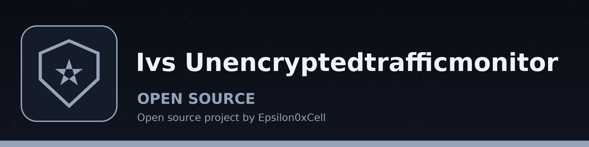

# ivs-UnencryptedTrafficMonitor
Listens on a network interface you name and reports plaintext HTTP, FTP, and Telnet traffic, with the source and destination IP addresses and ports. Detection is port based: traffic with a payload on port 80 is reported as HTTP, on port 21 as FTP, and on port 23 as Telnet, whether or not the payload spells the protocol name. A protocol word in a payload on an unrelated port is not reported. Payload contents are not logged, saved, or sent anywhere; the log holds only the protocol name, interface, addresses, and ports.

## Install
`git clone https://github.com/ShadowGuard-AI/ivs-unencryptedtrafficmonitor`

Packet capture needs privileges. Run it as root, or with the capture capability your system requires (for example CAP_NET_RAW on Linux), or the capture fails and the tool exits 1.

## Usage
`python3 main.py [params]`

## Parameters
- `-h`: Show help message and exit
- `-i`, `--interface`: Network interface to listen on (default: eth0).
- `-l`, `--log-file`: Path to the log file that warnings are appended to (default: ivs-UnencryptedTrafficMonitor.log).

## License
Copyright (c) ShadowStrikeHQ
